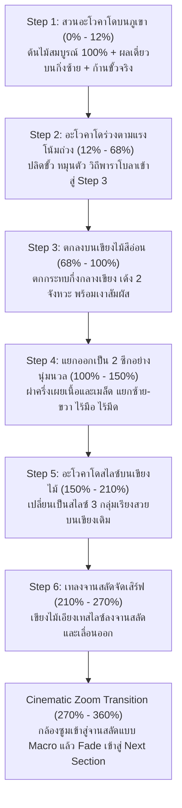

# Mae Chawi – AVOCADO ORCHARD (Scrollytelling Master Skill & Architecture Guide)

เอกสาร Skill นี้บันทึกสถาปัตยกรรมโครงสร้างเว็บไซต์ พิกัดเรขาคณิต การปรับจูนสเกลภาพ และการตั้งค่า **GSAP + ScrollTrigger** ทั้งหมดของโปรเจกต์ **Mae Chawi – AVOCADO ORCHARD** (`F:\Khet\งานส่วนตัว\mae-chawi-website\index.html`) ครอบคลุมการทำงานตั้งแต่ Step 1 ถึง Step 6 และ Cinematic Zoom Transition อย่างสมบูรณ์ 100%

---

## 1. ลำดับขั้นตอนเรื่องราวของเว็บไซต์ (Step 1–6 & Cinematic Zoom)



1. **Step 1 — สวนอะโวคาโดบนภูเขาแบบ Cinematic (`0% .. 12%`)**:
   - เปิดหน้าแรกด้วยทัศนียภาพสวนอะโวคาโดบนภูเขาสูงท่ามกลางทะเลหมอกและแสงแดดยามเช้า
   - ภาพต้นไม้ `step1-avocado-tree.png` สมบูรณ์ 100% กิ่ง ใบ ลำต้น และผลเดิมทุกผลอยู่ครบ
   - ผลอะโวคาโดที่จะร่วง (`avocado-whole.png`) วางบนกิ่งไม้จริงด้านซ้าย ต่อขั้วจริง (`avocado-stem.png`) แนบสนิท
   - มีการเคลื่อนไหวตามลม (Wind Sway) ร่วมกันอย่างเป็นธรรมชาติ ทั้งใบไม้ กิ่งไม้ ผลห้อย และผลที่จะร่วง
2. **Step 2 — อะโวคาโดร่วงตามแรงโน้มถ่วง (`12% .. 68%`)**:
   - เมื่อเริ่ม Scroll ผลอะโวคาโดปลิดจากขั้ว ก้านขั้วดีดตัวกลับเล็กน้อย (`rotation: 3.5, scaleY: 0.92`) ก่อนจางหายไป
   - ฉากหลังสวนบนภูเขาเลื่อนขึ้นและจางออก ผลอะโวคาโดลูกเดิมหมุนตัวสลับซ้าย-ขวาอย่างสมดุลตามแรงโน้มถ่วง
3. **Step 3 — ลูกอะโวคาโดตกลงบนเขียงไม้ (`68% .. 100%`)**:
   - เขียงไม้สีอ่อน (`Pic/cutting-board.png.png`) เลื่อนขึ้นมารองรับ
   - ผลอะโวคาโดตกลงกระทบกึ่งกลางเขียงไม้ที่พิกัด X=52.2%, Y=65.0%
   - เด้ง 2 จังหวะ (Bounce 1 ลอยขึ้น 25% height, Bounce 2 ลอยขึ้น 9% height) พร้อมเงาสัมผัส (`.avocado-board-shadow`)
4. **Step 4 — อะโวคาโดแยกออกเป็น 2 ซีก (`100% .. 150%`)**:
   - เชื่อมต่อ Crossfade ไร้รอยต่อเข้าสู่ `#halves-layer` (`Pic/avocado-halves.png`) ที่ตำแหน่งกึ่งกลางเขียงพอดี
   - สองซีกค่อยๆ แยกออกจากกันอย่างนุ่มนวลตามการเลื่อนหน้าเว็บ เผยเนื้อเนียนและเมล็ดชัดเจน (**ไม่มีมือ ไม่มีมีด เขียงไม้สีอ่อนคงเดิม**)
5. **Step 5 — อะโวคาโดสไลซ์บนเขียงไม้ (`150% .. 210%`)**:
   - เปลี่ยนจาก 2 ซีกเป็นชิ้นสไลซ์ 3 กลุ่ม (`Pic/avocado-slices-on-board2.png`) เรียงประณีตบนเขียงไม้ใบเดิมอย่างต่อเนื่อง
6. **Step 6 — เทลงจานสลัดและจัดเสิร์ฟ (`210% .. 270%`)**:
   - จานสลัด (`Pic/salad-plate.png`) เลื่อนขึ้นมาฝั่งขวา
   - เขียงไม้และชิ้นอะโวคาโดเอียงเทสไลซ์ลงสู่จานสลัดอย่างนุ่มนวล เขียงไม้จางหายไป และจานสลัดแสดงผลสมบูรณ์
7. **Cinematic Zoom Transition (`270% .. 360%`)**:
   - กล้องค่อยๆ Zoom in ต่อเนื่องเข้าหาจุดกึ่งกลางของจานสลัด (`scale(1.9)`) รักษาสัดส่วนภาพ 100%
   - เมื่อภาพสลัดขยายเต็มหน้าจอ ฉากสลัดจะ Fade Out พร้อมกับหน้าถัดไป (`#next-section-layer`) Fade In ต่อเนื่อง ไร้รอยต่อ
8. **Reverse Scroll Guarantees**:
   - เมื่อเลื่อนย้อนกลับขึ้นไป ทุกสเต็ปจะย้อนคืนสู่สภาพเดิมอย่างแม่นยำ และผลอะโวคาโดจะกลับมาติดขั้วบนกิ่งไม้เดิมที่ `scrollY = 0` ด้วยพิกัดระดับ Sub-pixel เดิม 100%

---

## 2. สถาปัตยกรรมเรขาคณิตและการคำนวณสเกล (Scale & Geometry Engine)

### 2.1 ระบบพิกัด 1:1 ระหว่าง Visual Stage
ทั้งฉาก Step 1 (`.step1-canvas-stage`) และฉาก Step 2–6 (`.stage-art`) ใช้ขนาดและพิกัดเดียวกัน:
```css
.stage-art, .step1-canvas-stage {
  position: absolute;
  right: clamp(12px, 3.5vw, 64px);
  top: calc(50% + 18px);
  transform: translateY(-50%);
  width: min(52vw, 740px);
  aspect-ratio: 1 / 1;
}
```

### 2.2 การแก้ไขปัญหาขนาดผลอะโวคาโด (Root Cause & Scale Calibration)
* **Parent Container Scale Mismatch**: คอนเทนเนอร์ของต้นไม้ `.step1-stage-content` ถูกขยายขนาดไว้ที่ `width: 288.78%` และ `height: 162.57%` ทำให้ผลไม้เดิมบนต้นไม้ (ขนาด 85–90px บนไฟล์ 1672px) เมื่อเรนเดอร์จริงใน Stage จะกว้างประมาณ **115px** (~15.5% ของ Stage 740px)
* **Asset Transparent Bounding Box**: ไฟล์ `avocado-whole.png` (2000 × 1695) มีขอบโปร่งใสข้างละ ~22% เนื้อผลไม้จริงกว้างเพียง **55.6%** (1112px)
* **วิธีแก้สเกล**: ปรับ CSS `.hero-avocado-wrap` ให้มี `width: 26.5%`:
  $$\text{Visible Fruit Width} = 26.5\% \times 55.6\% = 14.73\% \approx 109\text{px}$$
  ขนาดเนื้อผลจึงสมดุลกลมกลืนกับผลข้างเคียงบนต้นไม้ (108–115px) พอดี 100%

### 2.3 การวางตำแหน่ง ต่อก้านขั้วใหม่ (`avocado-stem-02.png`) และโครงสร้าง Kinematic Hierarchy
* **Nested Kinematic Transform Wrappers (ซิงก์การโยกตามต้นไม้ 100%)**:
  - `.step1-tree-motion-group` (`transform-origin: 67.6% 95.6%`) และ `.hero-tree-breeze-layer` (`transform-origin: 88.32% 101.27%`) หมุนรอบโคนต้นจุดเดียวกันด้วยมุม `treeAngle` เดียวกันทุกเฟรม (`±0.40°`, คาบครึ่งรอบ `8.5s`)
  - `.hero-branch-pendulum-layer` (`transform-origin: 25.38% 35.15%`) หมุนรอบจุดเชื่อมใต้กิ่งไม้ด้วยมุม `branchAngle` (`±0.75°`, คาบครึ่งรอบ `4.6s`)
  - `.hero-avocado-sway` (`transform-origin: 49.5% 3.0%`) แกว่งอิสระรอบขั้วผล (`±1.15°`, คาบครึ่งรอบ `3.6s`)
  - เมื่อ `tlTime <= 12` (`attachWeight = 1`) กิ่งไม้ ก้านขั้ว และผลอะโวคาโดจะเคลื่อนไหวเป็นชิ้นเดียวกันโดยจุดเชื่อมทั้งสองด้านไม่หลุดออกจากกัน และเมื่อ `12 < tlTime < 30` ค่า `attachWeight` จะลดลงแบบ Cosine (`C1 continuous`) จนเป็น `0` ขณะร่วงลงเขียง โดยที่ก้านขั้วคงติดอยู่กับกิ่งไม้บนต้น
* **ตำแหน่งผลอะโวคาโดบนกิ่งจริงด้านซ้าย (`.hero-avocado-wrap`)**:
  ```css
  .hero-avocado-wrap {
    position: absolute;
    left: 12.88%;
    top: 42.13%;
    width: 26.5%;
    aspect-ratio: 2000 / 1695;
    z-index: 6;
    transform-origin: 49.5% 49.2%;
  }
  ```
* **ตำแหน่งก้านขั้วใหม่จาก `avocado-stem-02.png` (`.hero-stem-img`)**:
  ```css
  .hero-stem-img {
    position: absolute;
    left: 24.95%;
    top: 35.10%;
    width: 1.90%;
    height: 8.55%;
    object-fit: fill;
    z-index: 7;
    transform-origin: 22.6% 2%;
  }
  ```
  คัดแยกเฉพาะก้านมุมล่างซ้าย (`X=209..261, Y=736..979`, ขนาด `53 × 241 px`) จาก `Pic/avocado-stem-02.png.png` พร้อมทำความสะอาด Alpha Transparency ไร้ขอบสีและกรอบสี่เหลี่ยม

### 2.5 ความเร็วหมอก 2 เท่า (Fog Animation 2x Speed)
* `.step1-fog-01`: `animation: fog-drift-01 11s ease-in-out infinite alternate` (เร็วขึ้น 2 เท่าจากเดิม `22s`, ระยะ `-2% .. 2.5%`)
* `.step1-fog-02`: `animation: fog-drift-02 14s ease-in-out infinite alternate` (เร็วขึ้น 2 เท่าจากเดิม `28s`, ระยะ `2% .. -3%`)

### 2.4 การตกกระทบเขียงใน Step 3 และส่งต่อเข้า Step 4 (Handoff Math)
* จุดกึ่งกลางเริ่มต้นของผลใน Stage: $X_0 = 26.0\%, Y_0 = 53.2\%$
* จุดกึ่งกลางเขียงไม้ (ตำแหน่งเดียวกับผ่า 2 ซีกใน Step 4): $X_{\text{land}} = 52.2\%, Y_{\text{land}} = 65.0\%$
* ค่า GSAP ที่คำนวณได้สำหรับการตกกระทบ:
  $$\Delta X = 52.2\% - 26.0\% = 26.2\% \implies \text{xPercent} = \frac{26.2\%}{26.5\%} \times 100 = \mathbf{+98.9}$$
  $$\Delta Y = 65.0\% - 53.2\% = 11.8\% \implies \text{yPercent} = \frac{11.8\%}{22.46\%} \times 100 = \mathbf{+52.7}$$
  $$\text{scale} = \mathbf{1.08} \implies \text{ความกว้างผลไม้} = 14.73\% \times 1.08 = 15.9\% \approx 118\text{px}$$
  ขนาดและตำแหน่งจะทับซ้อนกับ `#halves-layer` (ข้างละ ~119px) ใน Step 4 ได้อย่างแนบเนียน 100%

---

## 3. รายการ Asset และไฟล์ที่ใช้งาน (Complete Asset Manifest)

| โฟลเดอร์ / ไฟล์ | ขนาดภาพ (px) | สัดส่วน | หน้าที่ในระบบ |
| :--- | :--- | :--- | :--- |
| **`public/assets/step1/step1-bg-mountain.png`** | 1672 × 941 | 16:9 | พื้นหลังภูเขาและทะเลหมอก พร้อม Parallax |
| **`public/assets/step1/step1-fog-01.png`** | 2048 × 1170 | 1.75:1 | หมอกชั้นกลางลอยระหว่างภูเขากับต้นไม้ |
| **`public/assets/step1/step1-fog-02.png`** | 1365 × 2048 | 1:1.5 | หมอกชั้นหน้าลอยด้านหน้าต้นไม้ |
| **`public/assets/step1/step1-avocado-tree.png`** | 1672 × 941 | 1.776:1 | **ต้นไม้อะโวคาโดต้นฉบับดั้งเดิม 100%** (SHA256: `001A55BC...`) |
| **`public/assets/step1/step1-leaves-foreground.png`**| 1672 × 941 | 16:9 | ใบไม้กรอบหน้ามุมซ้ายบนและล่าง พลิ้วไหวตามลม |
| **`public/assets/step1/step1-avocado-hanging-01.png`**| 1086 × 1448 | 3:4 | ผลห้อยบนกิ่งขวาบน แกว่งแบบลูกตุ้ม |
| **`public/assets/step1/step1-avocado-hanging-02.png`**| 1086 × 1448 | 3:4 | ผลห้อยบนกิ่งขวาล่าง แกว่งแบบลูกตุ้ม |
| **`public/assets/step1/avocado-stem.png`** | 36 × 136 | 1:3.77 | ก้านขั้วไม้จริง เชื่อมใต้กิ่งลงมายังหัวผล |
| **`public/assets/step1/avocado-whole.png`** | 2000 × 1695 | 1.18:1 | **ผลอะโวคาโดเดี่ยวจริง** ใช้ต่อเนื่องตลอด Step 1–3 |
| **`Pic/cutting-board.png.png`** | 2000 × 1333 | 1.50:1 | เขียงไม้สีอ่อนธรรมชาติใน Step 3, 4, 5 และ 6 |
| **`Pic/avocado-halves.png`** | 2000 × 1538 | 1.30:1 | อะโวคาโดผ่า 2 ซีก แยกออกจากกันใน Step 4 |
| **`Pic/avocado-slices-on-board2.png`** | 2000 × 1116 | 1.79:1 | อะโวคาโดสไลซ์ 3 กลุ่มบนเขียงใน Step 5 และเทลงจานใน Step 6 |
| **`Pic/salad-plate.png`** | 2000 × 1333 | 1.50:1 | จานสลัดสดพร้อมเสิร์ฟใน Step 6 และ Cinematic Zoom |

---

## 4. รายละเอียด GSAP Timeline & ScrollTrigger Configuration

```javascript
// Step 1: Wind Sway & Stem Detachment (t = 0 .. 12)
masterTL.to('#step1-stage-content', { yPercent: -2.0, duration: 12, ease: 'none' }, 0);
masterTL.to('#step1-bg-mountain', { yPercent: 0.6, duration: 12, ease: 'none' }, 0);
masterTL.to('#hero-avocado-wrap', { rotation: -1.5, yPercent: 1.2, duration: 7, ease: 'sine.inOut' }, 0);
masterTL.to('#hero-stem', { rotation: -1.5, scaleY: 1.05, duration: 7, ease: 'sine.inOut' }, 0);
masterTL.to('#hero-avocado-wrap', { rotation: 2.2, yPercent: -0.4, duration: 5, ease: 'sine.in' }, 7);
masterTL.to('#hero-stem', { rotation: 3.5, scaleY: 0.92, duration: 4, ease: 'back.out(2)' }, 11);

// Step 2: Gravity Fall across scenery (t = 12 .. 72)
masterTL.to('#hero-stem', { autoAlpha: 0, duration: 8, ease: 'power1.out' }, 14);
masterTL.to('#step1-scenery', { yPercent: -45, scale: 1.03, autoAlpha: 0, duration: 36, ease: 'power1.inOut' }, 14);
masterTL.to('#hero-avocado-wrap', { xPercent: 98.9, duration: 60, ease: 'sine.inOut' }, 12);
masterTL.to('#hero-avocado-wrap', { scale: 1.08, duration: 60, ease: 'power1.inOut' }, 12);
masterTL.to('#hero-avocado-wrap', { yPercent: 52.7, duration: 60, ease: 'power2.in' }, 12);
masterTL.to('#hero-avocado-wrap', { rotation: -14, duration: 20, ease: 'sine.inOut' }, 12);
masterTL.to('#hero-avocado-wrap', { rotation: 15, duration: 22, ease: 'sine.inOut' }, 32);
masterTL.to('#hero-avocado-wrap', { rotation: -7, duration: 18, ease: 'sine.in' }, 54);

// Step 3: Landing & Bounce on Wooden Board (t = 72 .. 100)
masterTL.to('#board-layer', { yPercent: 1.4, duration: 2.5, ease: 'power2.out' }, 72);
masterTL.to('#board-layer', { yPercent: 0, duration: 4.5, ease: 'power2.inOut' }, 74.5);
masterTL.to('#hero-avocado-wrap', { yPercent: 27.7, rotation: 6, duration: 7.5, ease: 'power2.out' }, 72);
masterTL.to('#avocado-board-shadow', { autoAlpha: 0.48, scale: 1.26, duration: 7.5, ease: 'power2.out' }, 72);
masterTL.to('#hero-avocado-wrap', { yPercent: 52.7, rotation: -3, duration: 7, ease: 'power2.in' }, 79.5);
masterTL.to('#avocado-board-shadow', { autoAlpha: 0.95, scale: 0.98, duration: 7, ease: 'power2.in' }, 79.5);
masterTL.to('#hero-avocado-wrap', { yPercent: 43.7, rotation: 1.8, duration: 4.5, ease: 'power2.out' }, 86.5);
masterTL.to('#avocado-board-shadow', { autoAlpha: 0.72, scale: 1.08, duration: 4.5, ease: 'power2.out' }, 86.5);
masterTL.to('#hero-avocado-wrap', { yPercent: 52.7, rotation: 0, duration: 5, ease: 'power2.in' }, 91);
masterTL.to('#avocado-board-shadow', { autoAlpha: 0.96, scale: 1.0, duration: 5, ease: 'power2.in' }, 91);

// Step 4: Seamless transition to Two Halves (t = 100 .. 150)
masterTL.to('#hero-avocado-wrap', { autoAlpha: 0, duration: 7, ease: 'power1.inOut' }, 100);
masterTL.to('#halves-layer', { autoAlpha: 1, duration: 7, ease: 'power1.inOut' }, 100);
masterTL.to('#avocado-half-left', { xPercent: -22, yPercent: -4, rotation: -6.5, duration: 30, ease: 'power2.out' }, 108);
masterTL.to('#avocado-half-right', { xPercent: 22, yPercent: 4, rotation: 6.5, duration: 30, ease: 'power2.out' }, 108);
```

---

## 5. กฎข้อบังคับในการพัฒนาและบำรุงรักษา (Guiding Principles)

1. **ห้ามแตะต้องภาพต้นไม้ต้นฉบับ (`step1-avocado-tree.png`)**: ไม่ตัด เจาะโปร่งใส ลบผลไม้ หรือรีทัชภาพต้นไม้อีกเด็ดขาด เก็บผลไม้และกิ่งใบเดิมไว้ครบ 100%
2. **ใช้ผลเดี่ยวต่อเนื่อง (`avocado-whole.png`)**: ตลอด Step 1, 2 และ 3 ต้องใช้แท็ก `` เพียงตัวเดียวเท่านั้น ห้ามสลับรูปกลางคัน
3. **ห้ามใช้ภาพมือและมีด**: รักษาความมินิมอลตามดีไซน์ธรรมชาติของไร่แม่ฉวี ผ่าซีกด้วย Scroll Animation อัตโนมัติ
4. **ความสอดคล้องของระบบพิกัดเปอร์เซ็นต์**: ทุกองค์ประกอบต้องกำหนดขนาดและตำแหน่งเป็น `%` สัมพันธ์กับ Stage เพื่อให้รองรับทั้ง Desktop และ Mobile ได้ 100%
5. **Reverse Scroll Integrity**: ทุกการปรับแต่ง Timeline ต้องทดสอบการเลื่อนกลับสู่ `0%` เสมอ เพื่อรับรองว่าผลอะโวคาโดจะกลับมาติดขั้วบนกิ่งไม้เดิมอย่างไร้รอยต่อ
